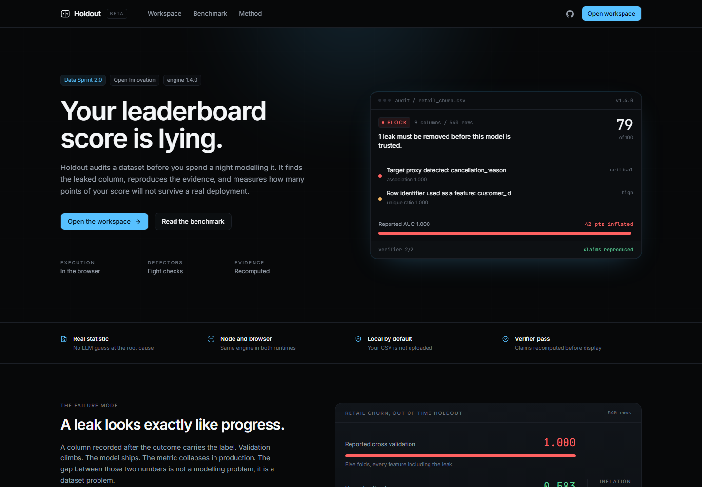

# Holdout

**Audit the dataset before you trust the score.**

Holdout finds dataset leakage and integrity problems, measures how much of a validation score survives once suspicious columns are removed, verifies its own findings, and returns a Ship, Review or Block verdict.

[Live app](https://holdout-taupe-iota.vercel.app) · [Benchmark](https://holdout-taupe-iota.vercel.app/benchmark) · [Method](https://holdout-taupe-iota.vercel.app/method)



## Problem

A leaked column can look like a strong predictor. The model memorises it, validation climbs, and production collapses. The gap between the two numbers is usually a dataset problem, not a modelling problem.

A retail churn table can include a cancellation reason recorded only after a customer leaves. Cross-validation reports AUC 1.000. Remove the leaked field and the honest estimate falls to 0.583. The reported score overstated performance by 41.7 percentage points.

## Solution

Holdout runs a six-stage audit before a model score is trusted:

1. **Profile** — column types, missing values, cardinality and duplicate rows from the raw file.
2. **Detect** — eight deterministic leakage checks against the declared target, time and entity columns.
3. **Quantify** — fit a regularised baseline with all features, then again without flagged columns. The difference is the honesty gap.
4. **Explain** — every finding carries its statistic, affected columns and a repair step.
5. **Verify** — a second code path recomputes each accepted finding. Unreproducible findings are dropped.
6. **Decide** — severity weights produce a readiness score and a Ship, Review or Block verdict. Any critical finding forces Block.

No LLM is used for any verdict. CSV parsing and audit computation happen in the browser; the dataset is not uploaded.

### Detectors

| Detector | What it catches |
|---|---|
| Target proxy | A feature that separates the label almost perfectly (AUC ≥ 0.95; correlation ≥ 0.93 for regression) |
| Row identifier | A key-like column with one distinct value per row |
| Post-outcome field | A column name that reads like it was written after the outcome, plus signal against the label |
| Duplicate rows | Identical feature rows that can land on both sides of a split |
| Entity overlap | The same entity appearing across rows in three or more groups |
| Temporal drift | Time predicting the label (AUC ≥ 0.62) |
| Zero variance | A column with a single distinct value |
| Class imbalance | Minority class below 6% of labelled rows |

## Proof

The engine is evaluated on **59 synthetic datasets** across seven leakage families plus clean controls.

| Metric | Result |
|---|---|
| F1 | **0.869** |
| Leak recall | **0.908** |
| Clean pass rate | **0.833** |
| Verified claims | **100%** |

The benchmark has a deliberately hard stress suite that sits under detection thresholds. The misses are documented in `data/benchmark.json` and on the benchmark page instead of being tuned away.

Run it yourself:

```bash
npm ci
npm test          # audit engine checks
npm run benchmark # regenerate the 59-dataset evaluation
```

The current benchmark output reports `datasets 59`, `recall 0.908`, `clean 0.833`, `f1 0.869` and `verified 1`.

## How it works

```text
CSV → profile → detect → quantify → explain → verify → verdict
```

The audit engine lives in `lib/audit/`. Detectors are pure functions with typed inputs and outputs. The verifier re-reads the raw table and recomputes accepted claims through a separate path. The UI never displays a finding that failed verification.

Verdicts:

- **Ship** — no critical integrity issue detected.
- **Review** — material risk detected; human review is recommended.
- **Block** — critical leakage or risk makes the current score unsafe to trust.

## Technology

- Next.js 16, React 19, TypeScript
- Tailwind CSS 4
- Deterministic audit engine
- Browser-local CSV processing
- Regularised logistic regression for classification comparison
- Ridge regression for regression comparison
- Node-compatible engine for tests and benchmark generation

## Demo

Live: **https://holdout-taupe-iota.vercel.app**

Open the workspace and load one of the bundled cases, or drop your own CSV. The benchmark page shows the full evaluation, including misses.

## Run locally

```bash
npm ci
npm run dev
```

Other commands:

```bash
npm run build
npm run start
npm run lint
npm run typecheck
npm run test
npm run benchmark
npm run cases
```

## Limitations

- The audit is CSV-first. It does not inspect database schemas, feature stores or training code.
- Detection is threshold-based. Weak leakage signals below a threshold are missed; the stress suite makes those misses visible.
- The honesty gap uses a regularised linear baseline. It measures score inflation, not the performance of your actual model.
- The clean pass rate is 0.833, not 1.0. False positives are part of the current behaviour.
- The browser engine is designed for practical dataset sizes; very large CSVs will be limited by tab memory.

## Documentation

- [`docs/architecture.md`](docs/architecture.md)
- [`docs/evaluation.md`](docs/evaluation.md)
- [`docs/problem-statement.md`](docs/problem-statement.md)
- [`docs/demo-script.md`](docs/demo-script.md)

## Author

Swapneel Sethi · [GitHub](https://github.com/Swapneel-Sethi)
